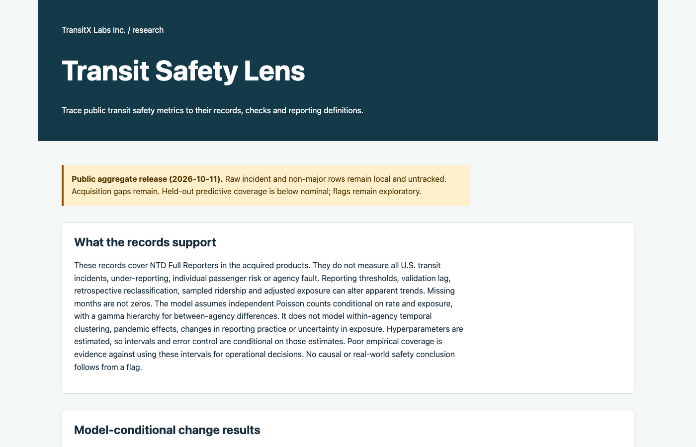
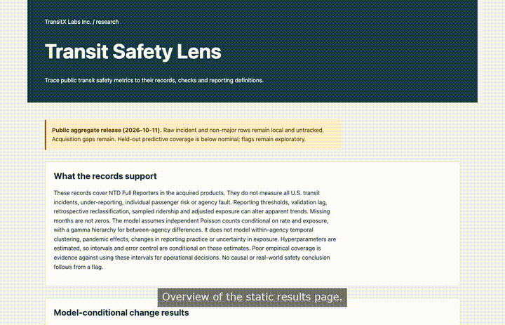
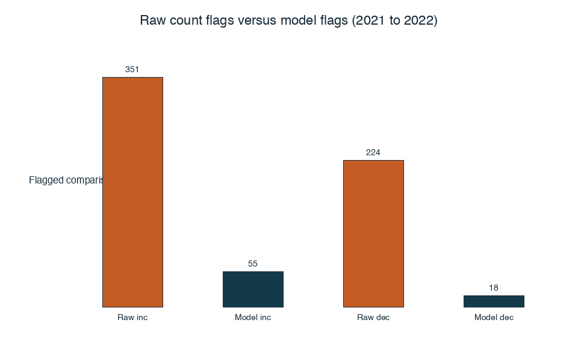
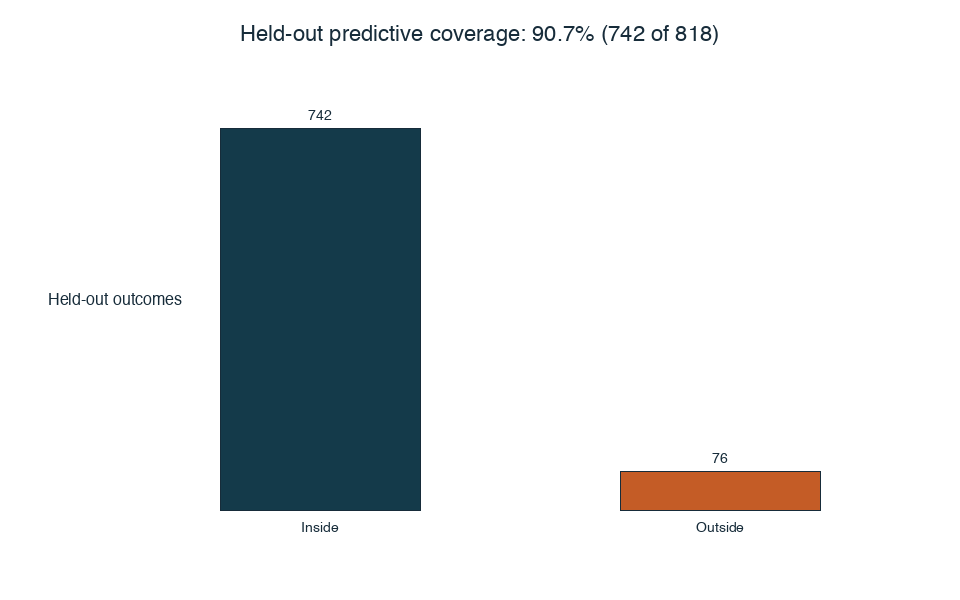
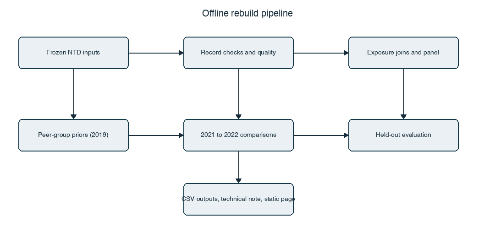
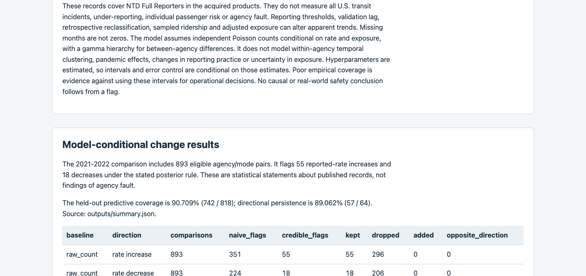
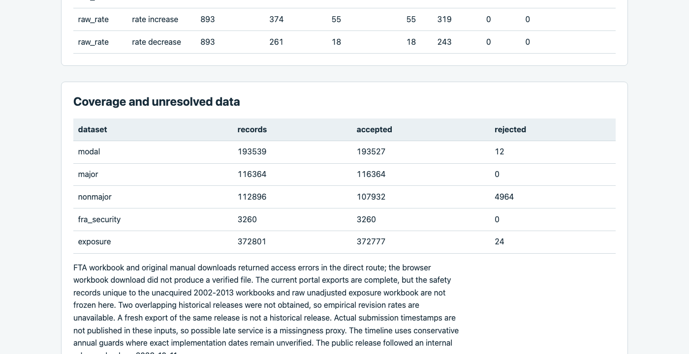

# Transit Safety Lens

Transit Safety Lens is a research package by TransitX Labs Inc. It checks how complete, consistent and comparable the official US National Transit Database safety records it acquired are. It estimates changes in reported event rates per vehicle revenue mile under a stated statistical model. For transit safety analysts, regulators and researchers who compare agencies' public safety records.



How it was made: its code and documentation were written with AI coding assistants and reviewed, tested and revised by Amir Daneshpajouh.

**[Try it live](https://transitxlabs.github.io/transit-safety-lens/)** (static summary page; no install required).

[](https://transitxlabs.github.io/transit-safety-lens/media/demo.mp4)

| Raw count versus model flags (2021 to 2022) | Held-out predictive coverage |
| --- | --- |
|  |  |



| Example outputs | |
| --- | --- |
|  |  |

## How it works

1. Acquire official National Transit Database products and freeze them with hashes.
2. Check every acquired row and record accepted and rejected rows.
3. Measure field completeness and rule-based quality rates, then link monthly event counts to vehicle revenue miles.
4. Fit peer-group priors on 2019 and compare 2021 with 2022 for each agency and mode (893 comparisons kept, 663 excluded within one definition regime).
5. Flag changes with posterior intervals and compare with raw count and rate flags; flags remain exploratory.
6. Evaluate held-out years: fit on earlier data, flag 2020 to 2021 changes and score 2022 coverage (below nominal 95 percent).

## Architecture


Components: `scripts/acquire.py` (optional network fetch), `src/transit_safety_lens/pipeline.py` (offline rebuild), quality and definition modules, gamma-Poisson model in `model.py`, and `publish.py` for README, technical note and `docs/site/index.html`.

## Design choices

- **Frozen hashes on every acquired file** so rebuilds detect any change to official inputs before recomputing aggregates.
- **Definition-regime guards** so year-to-year comparisons stay within one reporting rule set; blocked pairs are listed, not forced.
- **Raw baselines beside the stated model** so analysts can see how many naive count or rate flags the shrinkage rule drops or keeps.
- **Held-out coverage reported explicitly** because empirical interval coverage fell below the nominal 95 percent level in this release.

## Why it matters

Raw counts flagged 575 of 893 comparisons, the model 73; its prediction ranges caught fewer held-out results than 95 percent.

## Showcase media

Regenerate hero images, charts, captions and the demo video with:

```bash
python3 scripts/make_showcase_media.py
```

Requires Google Chrome, ffmpeg, and Pillow (installed with the package). Large `showcase-media/demo.mp4` stays local until Pages publish; copy it to `docs/media/demo.mp4` when enabling Pages.

**Status: public aggregate release (2026-10-11), with incident and non-major raw rows excluded from tracking. Acquisition and revision gaps remain; held-out coverage is below nominal and flags remain exploratory.**

## Frozen record coverage

| dataset | records | accepted | rejected | earliest | latest |
| --- | --- | --- | --- | --- | --- |
| modal | 193539 | 193527 | 12 | 2014-01-01 | 2026-08-01 |
| major | 116364 | 116364 | 0 | 2014-01-01 | 2026-06-01 |
| nonmajor | 112896 | 107932 | 4964 | 2008-01-01 | 2026-06-01 |
| fra_security | 3260 | 3260 | 0 | 2007-04-01 | 2026-07-01 |
| exposure | 372801 | 372777 | 24 | 2002-01-01 | 2026-08-01 |

Source counts, bytes, release timestamps, terms and SHA-256 hashes are in [data/manifest.json](data/manifest.json). Every acquired row is checked. The scope is the acquired official products, with the coverage gaps listed below.

## Change results and denominators

The model fits peer-group gamma priors to calendar year 2019, then compares 2021 with 2022. It retains 893 agency/mode comparisons and excludes 663. Under the conditional posterior rule, 73 comparisons receive a flag: 55 increases and 18 decreases. These are statistical statements about reported event rates.

| baseline | direction | comparisons | naive_flags | credible_flags | kept | dropped | added | opposite_direction |
| --- | --- | --- | --- | --- | --- | --- | --- | --- |
| raw_count | rate increase | 893 | 351 | 55 | 55 | 296 | 0 | 0 |
| raw_count | rate decrease | 893 | 224 | 18 | 18 | 206 | 0 | 0 |
| raw_rate | rate increase | 893 | 374 | 55 | 55 | 319 | 0 | 0 |
| raw_rate | rate decrease | 893 | 261 | 18 | 18 | 243 | 0 | 0 |

Examples are three eligible agency/mode keys selected in sorted order, not a ranking. Miles are vehicle revenue miles; ratios are later-period / earlier-period reported-event rates. Ratio intervals have 95% posterior probability under the fitted model.

| ntd_id | mode | events0 | events1 | miles0 | miles1 | ratio_lower | ratio_median | ratio_upper | flag |
| --- | --- | --- | --- | --- | --- | --- | --- | --- | --- |
| 00001 | DR | 0.0 | 0.0 | 4957756.0 | 6430224.0 | 0.0236 | 0.785 | 26.1 | no_flag |
| 00001 | FB | 5.0 | 0.0 | 49606.0 | 51236.0 | 9.23e-05 | 0.0437 | 0.604 | rate decrease |
| 00001 | MB | 181.0 | 234.0 | 31853373.0 | 30816322.0 | 1.1 | 1.33 | 1.61 | rate increase |

The held-out comparison fits on earlier data, flags 2020-2021 changes, and evaluates 2022. Predictive intervals cover 742 of 818 eligible outcomes (90.709%). Of 64 eligible flagged changes, 57 retain the same raw-rate direction relative to 2020 (89.062%). Empirical predictive coverage is below the nominal 95% level. Flags remain exploratory; persistence alone does not validate interval calibration. See [outputs/heldout.csv](outputs/heldout.csv).

All numbers above are generated from outputs/summary.json, inventory.csv, baseline_comparison.csv and credible_change.csv. The status field in outputs/summary.json labels the kind of output; the release status is stated in this README. [The technical note](docs/TECHNICAL_NOTE.md) explains the assumptions and [six-page PDF](docs/TECHNICAL_NOTE.pdf) provides a printable companion.

## Quality, provenance and definitions

All published field availability is measured as aggregate counts in outputs/field_completeness.csv.gz, including optional or redacted fields; nulls there are not automatically errors. Catalogue schemas and aggregate field names describe the audit without exposing source field values. See [outputs/quality_rates.csv](outputs/quality_rates.csv) for rule-specific numerators and eligible denominators by year, mode and agency size. The full quality_issues.csv and incident/non-major join logs remain local and untracked; public join_summary.csv and exposure_join_summary.csv retain aggregate match and loss counts. Possible late service is a proxy, not a measured late-submission rate. Source rows are identified by dataset and one-based CSV record ordinal, not physical line number. outputs/monthly_provenance.csv.gz links monthly aggregate rates to source hashes, records, rules and definition regimes; annual_panel.csv and priors.csv retain the monthly record lists used by comparisons.

[data/definitions/timeline.json](data/definitions/timeline.json) cites thresholds, categories, mode and service-code transitions, and publication revisions. Tests require a comparison to stay within one applicable regime. Recent comparisons blocked by conservative definition guards are listed in outputs/recent_comparison_exclusions.csv.

## Limits and acquisition gaps

These records cover NTD Full Reporters in the acquired products. They do not measure all U.S. transit incidents, under-reporting, individual passenger risk or agency fault. Reporting thresholds, validation lag, retrospective reclassification, sampled ridership and adjusted exposure can alter apparent trends. Missing months are not zeros. The model assumes independent Poisson counts conditional on rate and exposure, with a gamma hierarchy for between-agency differences. It does not model within-agency temporal clustering, pandemic effects, changes in reporting practice or uncertainty in exposure. Hyperparameters are estimated, so intervals and error control are conditional on those estimates. Poor empirical coverage is evidence against using these intervals for operational decisions. No causal or real-world safety conclusion follows from a flag.

FTA workbook and original manual downloads returned access errors in the direct route; the browser workbook download did not produce a verified file. The current portal exports are complete, but the safety records unique to the unacquired 2002-2013 workbooks and raw unadjusted exposure workbook are not frozen here. Two overlapping historical releases were not obtained, so empirical revision rates are unavailable. A fresh export of the same release is not a historical release. Actual submission timestamps are not published in these inputs, so possible late service is a missingness proxy. The timeline uses conservative annual guards where exact implementation dates remain unverified. The public release followed an internal release check on 2026-10-11.

## Rebuild and checks

Use Python 3.14 and the pinned dependencies in pyproject.toml. Install with `python -m pip install -e '.[dev]'`. Then `make rebuild` verifies frozen input hashes, processes every acquired record, and regenerates outputs, this README, the technical note and static page without network. `make check` runs lint, types and network-blocked fixtures. `python scripts/replay.py --destination work-tmp/replay-new --local-inputs .` exports the committed checkout and checks every rebuilt output hash against the committed output manifest. Use a new destination for every replay. Full rebuild and replay require the excluded local frozen inputs at their manifest paths; replay stages only size- and checksum-verified local inputs into the clean archive. The aggregate checkout alone cannot replay incident audits. The separate acquisition script requires official-source network access and a new ignored work-tmp destination; it never runs during rebuild or CI. A future download is a new release and cannot substitute for the recorded frozen bytes.

Code: Apache-2.0. Data: source-specific terms, including an unresolved non-major licence, in [DATA.md](DATA.md). Attribution: Federal Transit Administration, U.S. Department of Transportation, National Transit Database. No government endorsement is implied.
